# Morah — Documentação do Backend

Documentação técnica do backend do **Morah**, sistema de gestão de condomínios (projeto acadêmico
do 6º período de Engenharia de Software). Os diagramas estão em [Mermaid](https://mermaid.js.org/)
e são renderizados direto no GitHub, no GitLab e no IntelliJ (plugin Mermaid).

O contrato da API é o [`morah-openapi.yaml`](../morah-openapi.yaml) ("Morah API — Gestão
Condominial", v2.0.0). Como rodar e testar está no [`README.md`](../README.md).

## Sumário

1. [Visão geral](#1-visão-geral)
2. [Arquitetura](#2-arquitetura)
3. [Estrutura de pacotes](#3-estrutura-de-pacotes)
4. [Ciclo de uma requisição](#4-ciclo-de-uma-requisição)
5. [Autenticação e sessão](#5-autenticação-e-sessão)
6. [Perfis e permissões (RBAC)](#6-perfis-e-permissões-rbac)
7. [Módulos ativáveis](#7-módulos-ativáveis)
8. [Modelo de dados](#8-modelo-de-dados)
9. [Ciclo de vida dos status](#9-ciclo-de-vida-dos-status)
10. [Design patterns](#10-design-patterns)
11. [Fluxos de negócio](#11-fluxos-de-negócio)
12. [Tratamento de erros](#12-tratamento-de-erros)
13. [Dados de demonstração](#13-dados-de-demonstração)
14. [Testes](#14-testes)

---

## 1. Visão geral

O backend expõe uma API REST (55 operações) consumida pelo app do Morah. Cada pessoa entra com
e-mail e senha e passa a agir num **contexto** (condomínio + perfil + unidade). A partir daí, tudo o
que ela vê e faz é recortado por esse contexto, que viaja dentro do token JWT.

| Módulo | O que faz |
|---|---|
| Login | Login, sessão, troca de contexto, refresh e logout |
| Tela Inicial | Painel agregado, diferente para cada perfil |
| Financeiro | Cobranças, PIX simulado, baixa manual, webhook do gateway, taxas/rateio, documentos e inadimplência |
| Portaria | Visitantes, autorização de entrada pelo morador, registro de entrada e saída |
| Avisos | Mural de comunicados com público-alvo e controle de leitura |
| Reservas | Áreas comuns, disponibilidade, reservas e vistoria |
| Minha Unidade | Dados da unidade, vínculos, solicitações de vínculo e inquilinos |
| Encomendas | Recebimento, código de retirada, autorização de terceiros e extravio |
| Notificações | Notificações internas geradas pelos demais módulos |
| Personalização | Identidade visual e ativação/desativação de módulos |

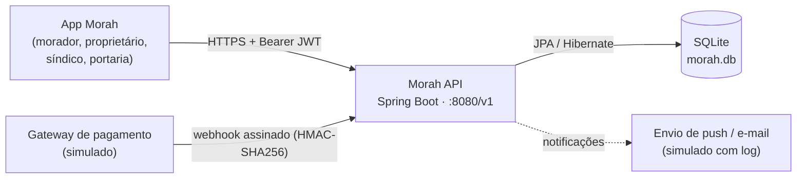

## 2. Arquitetura

Arquitetura em camadas (MVC), sem interfaces nem abstrações que não sejam usadas.

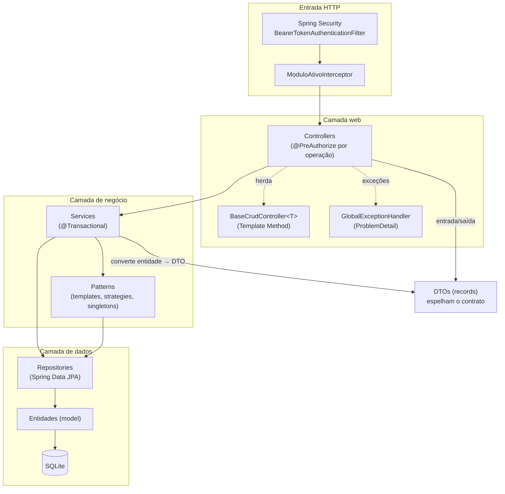

| Camada | Responsabilidade | Exemplo |
|---|---|---|
| `controller` | Recebe a requisição, valida o corpo (`@Valid`), aplica o RBAC (`@PreAuthorize`) e devolve o status HTTP do contrato | `AvisoController.criarAviso` |
| `service` | Regras de negócio, escopo de condomínio/unidade e conversão entidade → DTO | `AvisoService.criarAviso` |
| `repository` | Consultas ao banco (métodos derivados do Spring Data ou JPQL) | `AvisoRepository.buscarVigentes` |
| `model` | Entidades JPA (tabelas em snake_case) | `Aviso`, `PublicoAlvo` (@Embeddable) |
| `dto` | Um `record` por schema do contrato e um `enum` por enum do contrato | `AvisoCreateRequest`, `PrioridadeAviso` |
| `pattern` | Os 8 usos de design patterns | `NotificacaoTemplate`, `EstrategiaRateio` |
| `security` / `config` | JWT, filtros, interceptor, conversão de enums, Swagger | `SecurityConfig`, `TokenService` |
| `exception` | Erros de negócio e o tratamento único em RFC 9457 | `ApiException`, `GlobalExceptionHandler` |

## 3. Estrutura de pacotes

`dto`, `model` e `repository` são agrupados por módulo; `pattern` é agrupado por tipo de pattern,
com uma subpasta para cada uso.

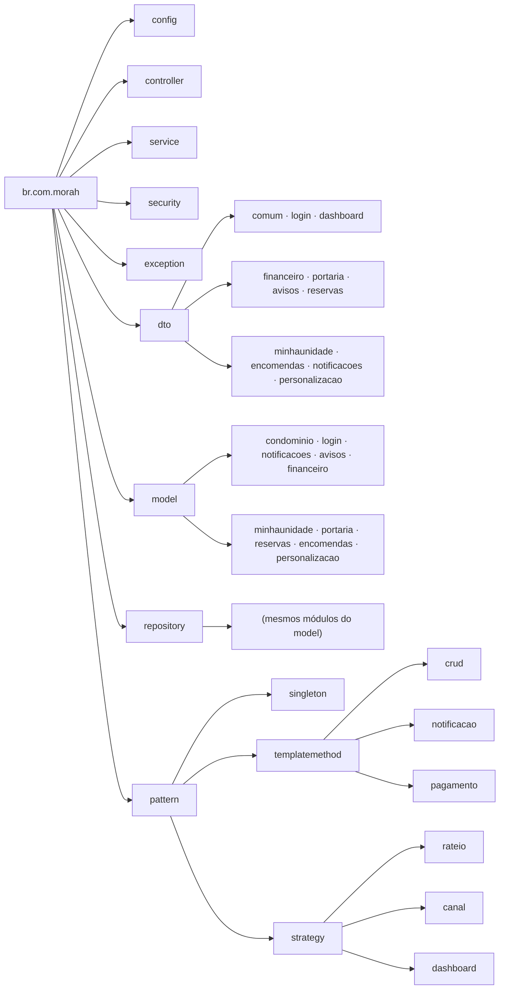

Dependências entre os pacotes principais (a seta indica "usa"):

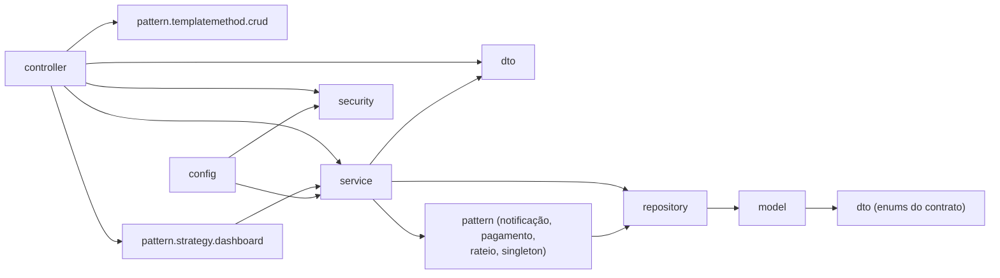

## 4. Ciclo de uma requisição

Exemplo: `GET /reservas/{id}` feito por um morador.

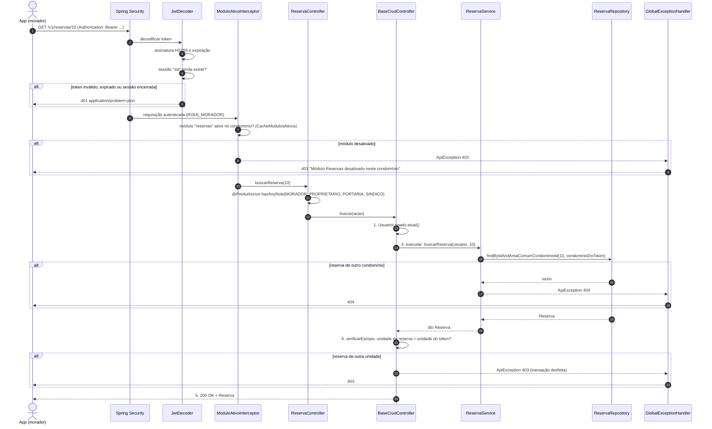

## 5. Autenticação e sessão

- Senha conferida com **BCrypt**; no banco fica só o hash.
- Cada login cria uma **`Sessao`** (id UUID, contexto ativo e refresh token UUID válido por 7 dias).
- O **access token** é um JWT HS256 de 1 hora, gerado pelo `TokenService` com o `NimbusJwtEncoder`.
- O `JwtDecoder` valida assinatura e expiração e, com um validador próprio, se a sessão do `sid`
  ainda existe. Por isso o logout invalida o token na hora, mesmo antes de expirar.

Claims do access token:

| Claim | Conteúdo | Exemplo |
|---|---|---|
| `sub` | id da pessoa | `"2"` |
| `sid` | id da sessão | `"61b0fd3d-..."` |
| `perfil` | perfil ativo | `"proprietario"` |
| `condominio_id` | condomínio ativo | `1` |
| `unidade_id` | unidade ativa (ausente para síndico e portaria) | `1` |
| `iat` / `exp` | emissão e expiração (1 hora) | — |

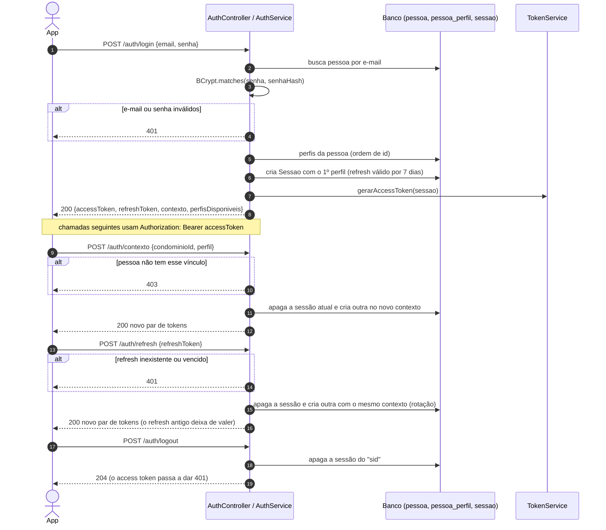

## 6. Perfis e permissões (RBAC)

A claim `perfil` vira o papel `ROLE_<PERFIL>`. O **proprietário é cumulativo ao morador**: recebe
`ROLE_PROPRIETARIO` e `ROLE_MORADOR`. Cada método de controller tem um `@PreAuthorize` com exatamente
os perfis do contrato.

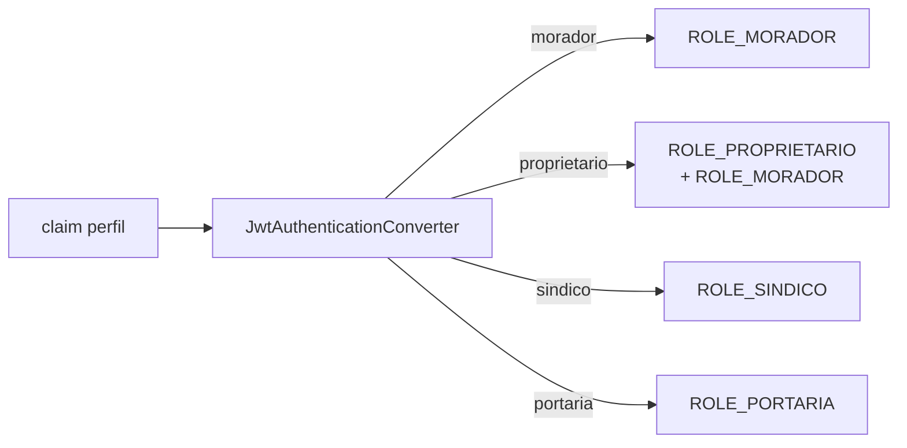

Matriz de permissões (✔ = perfil aceito; rotas públicas não exigem token):

| Operação | Morador | Proprietário | Síndico | Portaria |
|---|:-:|:-:|:-:|:-:|
| `POST /auth/login`, `POST /auth/refresh` | público | público | público | público |
| `GET /auth/me`, `POST /auth/contexto`, `POST /auth/logout` | ✔ | ✔ | ✔ | ✔ |
| `GET /home/dashboard` | ✔ | ✔ | ✔ | ✔ |
| `GET /financeiro/cobrancas`, `GET /financeiro/cobrancas/{id}` | ✔ | ✔ | ✔ | |
| `GET /financeiro/cobrancas/{id}/pix` | ✔ | ✔ | | |
| `POST /financeiro/cobrancas/{id}/baixa-manual` | | | ✔ | |
| `POST /financeiro/webhooks/pagamentos` | assinatura HMAC | | | |
| `GET /financeiro/documentos` | ✔ | ✔ | ✔ | |
| `POST /financeiro/documentos`, `POST /financeiro/taxas`, `POST .../gerar-cobrancas`, `GET /financeiro/inadimplencia` | | | ✔ | |
| `POST /portaria/visitantes`, `POST .../reenviar`, `POST /portaria/acessos` | | | | ✔ |
| `GET /portaria/autorizacoes`, `GET /portaria/autorizacoes/{id}` | ✔ | ✔ | | ✔ |
| `PATCH /portaria/autorizacoes/{id}/decisao` | ✔ | ✔ | | |
| `GET /portaria/acessos` | | | ✔ | ✔ |
| `GET /avisos`, `GET /avisos/{id}` | ✔ | ✔ | ✔ | ✔ |
| `POST /avisos`, `PATCH /avisos/{id}`, `DELETE /avisos/{id}` | | | ✔ | |
| `GET /areas-comuns` | ✔ | ✔ | ✔ | ✔ |
| `GET /areas-comuns/{id}/disponibilidade` | ✔ | ✔ | | |
| `GET /reservas`, `GET /reservas/{id}` | ✔ | ✔ | ✔ | ✔ |
| `POST /reservas`, `DELETE /reservas/{id}` | ✔ | ✔ | | |
| `POST /reservas/{id}/vistoria` | | | | ✔ |
| `GET /unidades/minha`, `GET /unidades/minha/vinculos`, `POST /unidades/minha/vinculos/solicitacoes` | ✔ | ✔ | | |
| `POST /unidades/minha/inquilinos`, `DELETE /unidades/minha/inquilinos/{id}` | | ✔ | | |
| `GET /unidades/{id}`, `GET/PATCH /unidades/{id}/vinculos/solicitacoes...` | | | ✔ | |
| `GET /encomendas`, `GET /encomendas/{id}` | ✔ | ✔ | ✔ | ✔ |
| `POST /encomendas`, `POST /encomendas/{id}/retirada` | | | | ✔ |
| `POST /encomendas/{id}/autorizacoes-retirada`, `POST /encomendas/{id}/ocorrencias` | ✔ | ✔ | | |
| `GET /notificacoes`, `PATCH /notificacoes/{id}/lida` | ✔ | ✔ | ✔ | ✔ |
| `GET /condominio/personalizacao`, `GET /condominio/modulos` | ✔ | ✔ | ✔ | ✔ |
| `PATCH /condominio/personalizacao`, `PATCH /condominio/modulos/{modulo}` | | | ✔ | |

Além do perfil, há o **escopo dos dados**:

- condomínio, unidade e perfil vêm **sempre do token** (`UsuarioLogado`), nunca da URL. A exceção são
  as rotas administrativas `/unidades/{unidadeId}` do síndico, que ainda assim ficam restritas ao
  condomínio ativo;
- morador/proprietário acessando recurso de outra unidade → **403** (`UsuarioLogado.verificarUnidade`);
- recurso de outro condomínio → **404** (as consultas sempre filtram pelo condomínio do token).

## 7. Módulos ativáveis

O síndico pode desativar `financeiro`, `portaria`, `avisos`, `reservas`, `minha_unidade` e
`encomendas`. O `ModuloAtivoInterceptor` roda antes de todo controller e consulta o Singleton
`CacheModulosAtivos`, que só vai ao banco na primeira vez e depois de cada alteração.

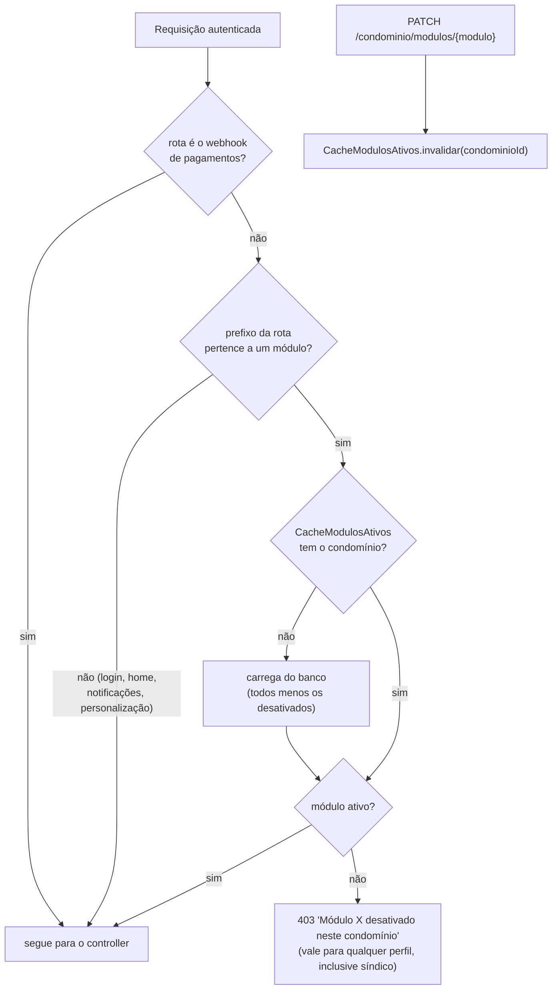

| Prefixo da rota | Módulo |
|---|---|
| `/financeiro/**` (menos o webhook) | `financeiro` |
| `/portaria/**` | `portaria` |
| `/avisos/**` | `avisos` |
| `/areas-comuns/**` e `/reservas/**` | `reservas` |
| `/unidades/**` | `minha_unidade` |
| `/encomendas/**` | `encomendas` |

Na tela inicial, as seções de módulos desativados vêm vazias (`[]` ou `0`). Com o financeiro
desativado, `inadimplencia` não aparece no painel do síndico.

## 8. Modelo de dados

25 tabelas geradas pelo Hibernate (`ddl-auto: update`) a partir das entidades, mais a tabela auxiliar
`vistoria_fotos_url` da `@ElementCollection`. Os enums são gravados pelo nome da constante (ex.:
`AGUARDANDO_RETIRADA`) e as datas como texto `yyyy-MM-dd HH:mm:ss.SSS` (instantes em UTC).

### 8.1 Visão geral dos relacionamentos

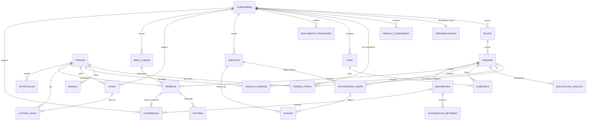

### 8.2 Condomínio, pessoas e acesso

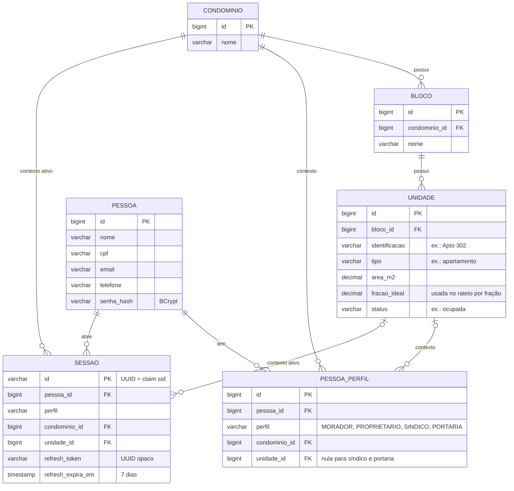

### 8.3 Minha Unidade

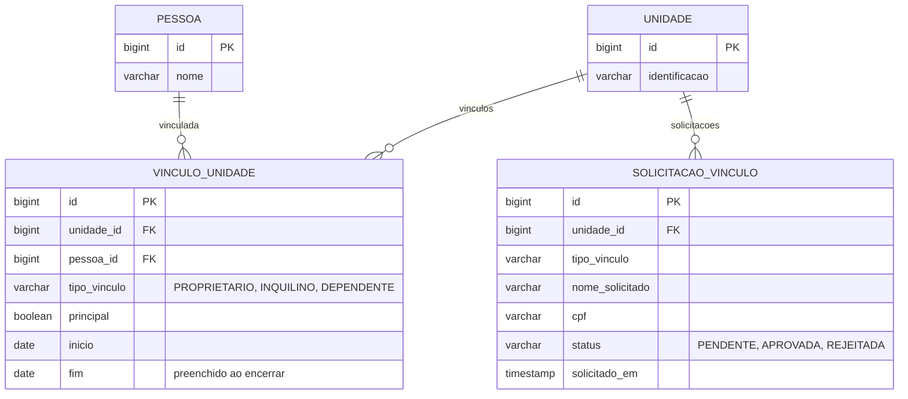

### 8.4 Financeiro

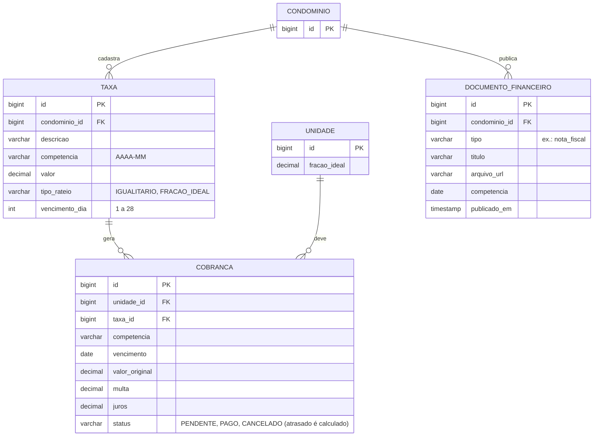

### 8.5 Portaria

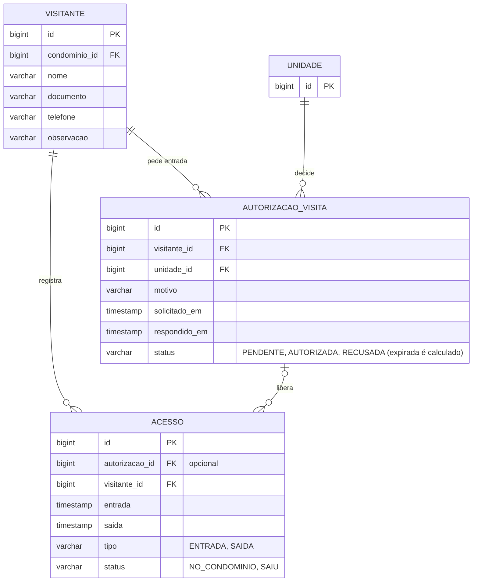

### 8.6 Avisos

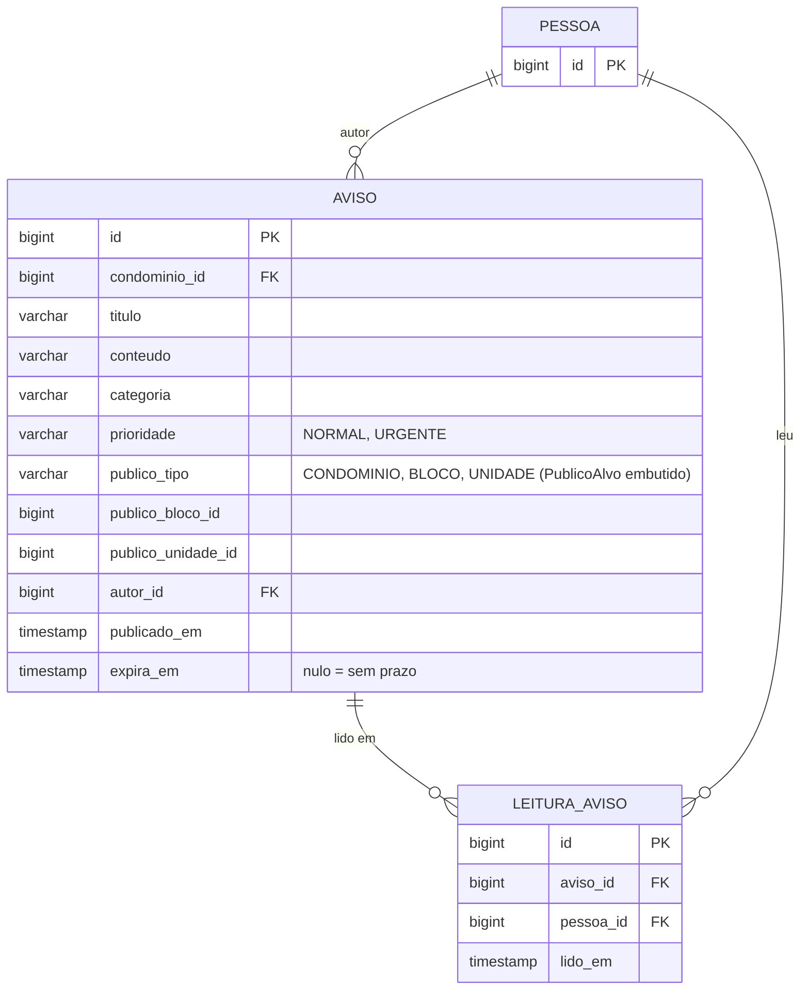

### 8.7 Reservas, encomendas e ocorrências

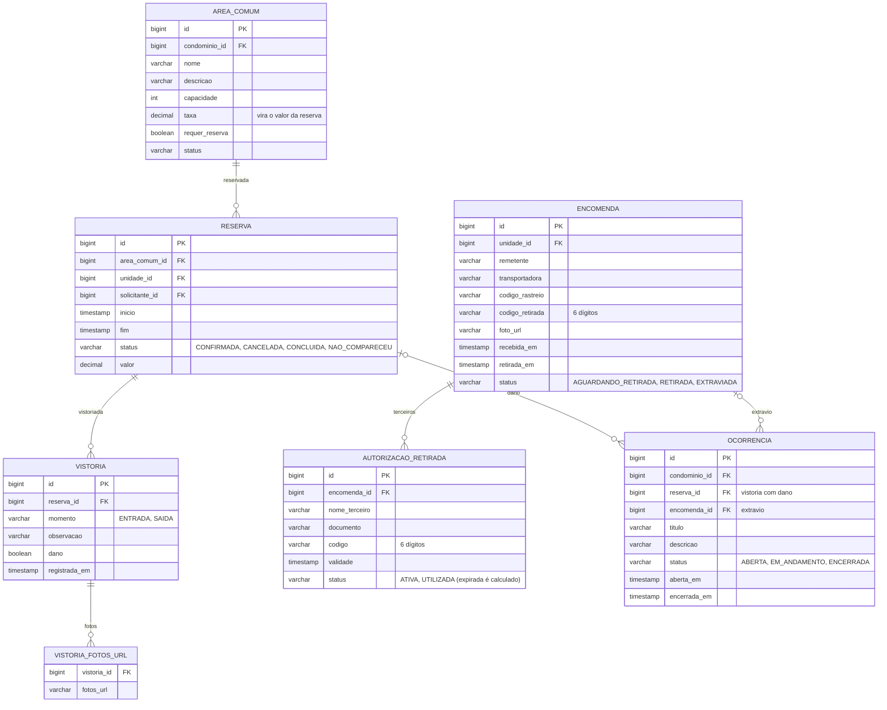

### 8.8 Notificações e personalização

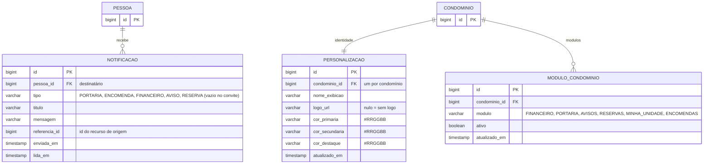

## 9. Ciclo de vida dos status

Alguns status **não são gravados**: são calculados na leitura, sem job agendado
(`atrasado`, `expirada`). Nos diagramas, eles aparecem com a anotação "calculado".

### Cobrança

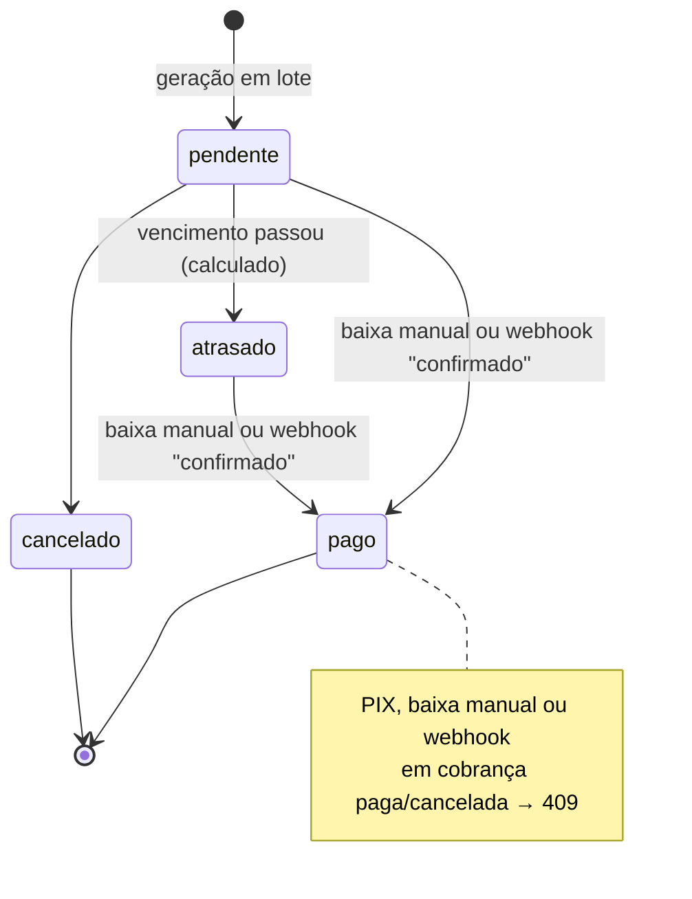

### Autorização de visita e acesso

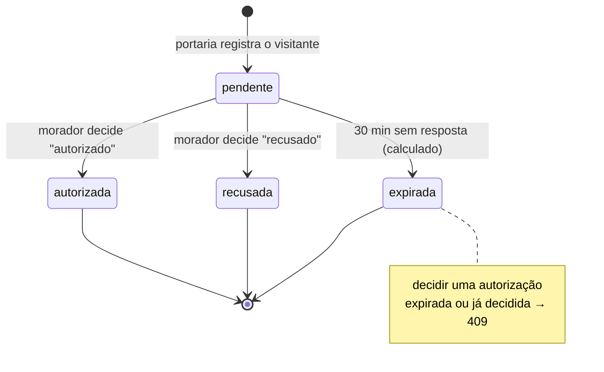

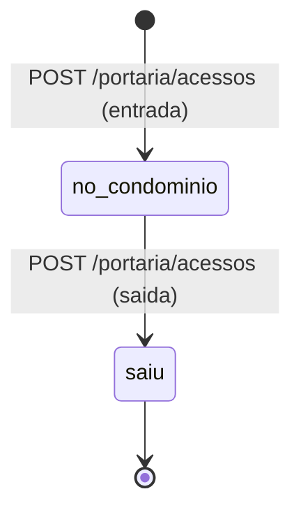

### Reserva

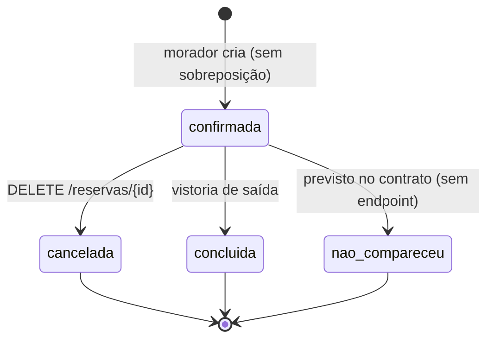

### Encomenda e autorização de retirada

```mermaid
stateDiagram-v2
    [*] --> aguardando_retirada: portaria registra (código de 6 dígitos)
    aguardando_retirada --> retirada: código da encomenda ou de terceiro válido
    aguardando_retirada --> extraviada: morador abre ocorrência
    retirada --> [*]
    extraviada --> [*]
```

```mermaid
stateDiagram-v2
    [*] --> ativa: morador autoriza terceiro
    ativa --> utilizada: usada na retirada
    ativa --> expirada: validade vencida (calculado)
    utilizada --> [*]
    expirada --> [*]
```

### Solicitação de vínculo

```mermaid
stateDiagram-v2
    [*] --> pendente: morador solicita
    pendente --> aprovada: síndico aprova (cria pessoa e vínculo)
    pendente --> rejeitada: síndico rejeita
    aprovada --> [*]
    rejeitada --> [*]
```

## 10. Design patterns

São **8 usos**: 3 Template Method, 3 Strategy e 2 Singleton.

| # | Pattern | Pacote | Problema que resolve |
|---|---|---|---|
| 1 | Template Method | `pattern.templatemethod.crud` | Fluxo fixo dos endpoints de CRUD |
| 2 | Template Method | `pattern.templatemethod.notificacao` | Roteiro único para notificar |
| 3 | Template Method | `pattern.templatemethod.pagamento` | Roteiro único para quitar uma cobrança |
| 4 | Strategy | `pattern.strategy.rateio` | Cálculo do valor por unidade |
| 5 | Strategy | `pattern.strategy.canal` | Canal de envio da notificação |
| 6 | Strategy | `pattern.strategy.dashboard` | Tela inicial por perfil |
| 7 | Singleton (GoF, holder) | `pattern.singleton` | Um único `SecureRandom` para os códigos |
| 8 | Singleton (enum) | `pattern.singleton` | Cache em memória dos módulos ativos |

### 10.1 Template Method — `BaseCrudController<T>`

Fluxo fixo: **obter o usuário → validar payload → executar → verificar escopo → responder**, dentro
de uma transação (se o escopo for negado, o que foi executado é desfeito).

```mermaid
classDiagram
    direction TB
    class BaseCrudController~T~ {
        <<abstract>>
        ~TransactionTemplate transacao
        #validar(Object input) void
        #verificarEscopo(T recurso, UsuarioLogado usuario)* void
        #criar(Object input, Function acao) ResponseEntity~T~
        #alterar(Object input, Function acao) ResponseEntity~T~
        #deletar(Function acao) ResponseEntity~Void~
        #buscar(Function acao) ResponseEntity~T~
        #buscarTodos(Function acao, Function itens) ResponseEntity~P~
        -executarFluxo(input, acao, recursos) R
    }
    class AvisoController {
        +buscarAvisos() ResponseEntity~AvisoPage~
        +criarAviso() ResponseEntity~Aviso~
        +buscarAviso() ResponseEntity~Aviso~
        +alterarAviso() ResponseEntity~Aviso~
        +deletarAviso() ResponseEntity~Void~
        #validar(Object input) void
        #verificarEscopo(Aviso, UsuarioLogado) void
    }
    class ReservaController {
        +buscarReservas()
        +criarReserva()
        +buscarReserva()
        +deletarReserva()
        #validar(Object input) void
        #verificarEscopo(Reserva, UsuarioLogado) void
    }
    class EncomendaController {
        +buscarEncomendas()
        +criarEncomenda()
        +buscarEncomenda()
        #verificarEscopo(Encomenda, UsuarioLogado) void
    }
    BaseCrudController <|-- AvisoController : T = Aviso
    BaseCrudController <|-- ReservaController : T = Reserva
    BaseCrudController <|-- EncomendaController : T = Encomenda
```

```mermaid
sequenceDiagram
    participant C as Controller concreto
    participant B as BaseCrudController
    participant TX as TransactionTemplate
    participant S as Service
    C->>B: criar(input, acao)
    B->>TX: execute
    TX->>B: 1. UsuarioLogado.atual()
    TX->>C: 2. validar(input) (gancho)
    TX->>S: 3. acao.apply(usuario)
    S-->>TX: recurso
    TX->>C: 4. verificarEscopo(recurso, usuario) (gancho)
    alt escopo negado
        C-->>TX: ApiException 403
        TX-->>B: rollback
    else escopo ok
        TX-->>B: commit
        B-->>C: 5. ResponseEntity 201
    end
```

### 10.2 Template Method — `NotificacaoTemplate<E>` (com a Strategy `CanalNotificacao`)

```mermaid
classDiagram
    direction LR
    class NotificacaoTemplate~E~ {
        <<abstract>>
        +notificar(E evento, List~Pessoa~ destinatarios) void
        #montarPayload(E evento)* Notificacao
        #escolherCanal(Notificacao payload) CanalNotificacao
        #registrar(Pessoa destinatario, Notificacao payload) void
        #payload(tipo, titulo, mensagem, referenciaId) Notificacao
    }
    class NotificacaoAviso
    class NotificacaoVisitante
    class NotificacaoEncomenda
    class NotificacaoReserva
    class NotificacaoFinanceiro
    class NotificacaoConvite {
        #escolherCanal(Notificacao payload) CanalNotificacao
    }
    class CanalNotificacao {
        <<interface>>
        +enviar(Pessoa destinatario, Notificacao notificacao) void
    }
    class CanalPush
    class CanalEmail

    NotificacaoTemplate <|-- NotificacaoAviso : E = Aviso
    NotificacaoTemplate <|-- NotificacaoVisitante : E = AutorizacaoVisita
    NotificacaoTemplate <|-- NotificacaoEncomenda : E = Encomenda
    NotificacaoTemplate <|-- NotificacaoReserva : E = Reserva
    NotificacaoTemplate <|-- NotificacaoFinanceiro : E = Cobranca
    NotificacaoTemplate <|-- NotificacaoConvite : E = VinculoUnidade
    CanalNotificacao <|.. CanalPush
    CanalNotificacao <|.. CanalEmail
    NotificacaoTemplate o-- CanalPush
    NotificacaoTemplate o-- CanalEmail
```

`notificar()` é `final`: **montar payload → escolher canal → enviar → registrar**. O canal padrão é
e-mail para `financeiro` e push para os demais; o convite de inquilino sobrescreve e usa sempre e-mail.

| Evento | Template | Canal | Destinatários |
|---|---|---|---|
| Aviso publicado | `NotificacaoAviso` | push | público-alvo (menos o autor) |
| Visitante registrado / reenvio | `NotificacaoVisitante` | push | moradores da unidade |
| Encomenda recebida | `NotificacaoEncomenda` | push | moradores da unidade |
| Reserva criada | `NotificacaoReserva` | push | solicitante |
| Cobrança gerada / pagamento confirmado | `NotificacaoFinanceiro` | e-mail | moradores da unidade |
| Convite de inquilino | `NotificacaoConvite` | e-mail | o inquilino |

### 10.3 Template Method — `ProcessamentoPagamentoTemplate<E>`

```mermaid
classDiagram
    direction TB
    class ProcessamentoPagamentoTemplate~E~ {
        <<abstract>>
        +processar(E entrada) Cobranca
        #validarOrigem(E entrada)* Long
        #localizarCobranca(Long id) Cobranca
        #verificarSePodeSerPaga(Cobranca c) void
        #marcarComoPago(Cobranca c) void
        #notificarUnidade(Cobranca c) void
    }
    class BaixaManualProcessador {
        #validarOrigem(Long cobrancaId) Long
    }
    class WebhookPagamentoProcessador {
        +CABECALHO_ASSINATURA$ String
        #validarOrigem(HttpEntity~String~ requisicao) Long
        +assinar(String corpo, String segredo)$ String
    }
    ProcessamentoPagamentoTemplate <|-- BaixaManualProcessador : E = Long
    ProcessamentoPagamentoTemplate <|-- WebhookPagamentoProcessador : E = HttpEntity
    ProcessamentoPagamentoTemplate ..> NotificacaoFinanceiro : notifica
```

```mermaid
flowchart LR
    v["1. validarOrigem<br/>(varia)"] --> n{"devolveu<br/>cobrancaId?"}
    n -- "null (webhook 'falhou')" --> fim["encerra sem alterar nada"]
    n -- sim --> l["2. localizarCobranca"] --> c["3. verificarSePodeSerPaga<br/>(paga/cancelada → 409)"] --> m["4. marcarComoPago"] --> no["5. notificarUnidade"]
```

| Origem | Validação da origem |
|---|---|
| Baixa manual | perfil síndico (senão 403) e cobrança do condomínio do token (senão 404) |
| Webhook | assinatura HMAC-SHA256 do corpo bruto no cabeçalho `X-Webhook-Signature` (senão 401); payload válido (senão 400); `falhou` → para |

### 10.4 Strategy — `EstrategiaRateio`

```mermaid
classDiagram
    direction LR
    class EstrategiaRateio {
        <<interface>>
        +getTipo() TipoRateio
        +calcularValor(BigDecimal valorTaxa, Unidade unidade, int totalUnidades) BigDecimal
    }
    class RateioIgualitario {
        valorTaxa ÷ totalUnidades
    }
    class RateioFracaoIdeal {
        valorTaxa × fracaoIdeal
    }
    EstrategiaRateio <|.. RateioIgualitario
    EstrategiaRateio <|.. RateioFracaoIdeal
    FinanceiroService --> EstrategiaRateio : escolhe pelo tipoRateio da taxa
```

Arredondamento em 2 casas com `HALF_UP`. Unidade sem fração ideal (no rateio por fração) ou já
cobrada pela mesma taxa vai para a lista `falhas` da resposta.

### 10.5 Strategy — `MontadorDashboard`

```mermaid
classDiagram
    direction LR
    class MontadorDashboard {
        <<interface>>
        +LIMITE_ITENS$ int = 5
        +atende(Perfil perfil) boolean
        +montar(UsuarioLogado usuario) Dashboard
    }
    class DashboardMoradorMontador {
        atende MORADOR e PROPRIETARIO
    }
    class DashboardSindicoMontador {
        atende SINDICO
    }
    class DashboardPortariaMontador {
        atende PORTARIA
    }
    class Dashboard {
        <<sealed interface>>
    }
    class DashboardMorador {
        <<record>>
    }
    class DashboardSindico {
        <<record>>
    }
    class DashboardPortaria {
        <<record>>
    }
    MontadorDashboard <|.. DashboardMoradorMontador
    MontadorDashboard <|.. DashboardSindicoMontador
    MontadorDashboard <|.. DashboardPortariaMontador
    Dashboard <|.. DashboardMorador
    Dashboard <|.. DashboardSindico
    Dashboard <|.. DashboardPortaria
    DashboardMoradorMontador ..> DashboardMorador : cria
    DashboardSindicoMontador ..> DashboardSindico : cria
    DashboardPortariaMontador ..> DashboardPortaria : cria
    DashboardController --> MontadorDashboard : escolhe pelo perfil ativo
```

| Painel | Seções (máx. 5 itens nas listas) |
|---|---|
| Morador / proprietário | `unidade`, `proximosBoletos`, `avisosRecentes`, `encomendasPendentes`, `autorizacoesPendentes`, `proximasReservas` |
| Síndico | `inadimplencia`, `avisosPublicadosRecentes`, `solicitacoesVinculoPendentes`, `ocorrenciasAbertas` |
| Portaria | `autorizacoesPendentes`, `reservasDoDia`, `encomendasRecebidasHoje` |

### 10.6 Singletons

```mermaid
classDiagram
    direction LR
    class GeradorCodigo {
        <<final>>
        -SecureRandom aleatorio
        -GeradorCodigo()
        +getInstance()$ GeradorCodigo
        +gerarCodigo() String
    }
    class Holder {
        <<static, private>>
        -INSTANCIA$ GeradorCodigo
    }
    class CacheModulosAtivos {
        <<enumeration>>
        INSTANCE
        -Map~Long, Set~ModuloCodigo~~ ativosPorCondominio
        +buscarAtivos(Long condominioId, Function carregador) Set~ModuloCodigo~
        +invalidar(Long condominioId) void
    }
    GeradorCodigo *-- Holder : classe interna
    EncomendaService ..> GeradorCodigo : códigos de 6 dígitos
    CondominioService ..> CacheModulosAtivos : isModuloAtivo / invalidar
    ModuloAtivoInterceptor ..> CondominioService
```

| Singleton | Forma | Por que é único |
|---|---|---|
| `GeradorCodigo` | GoF clássico: construtor privado + `getInstance()` com a classe interna *holder* (criação preguiçosa e thread-safe pela JVM) | `SecureRandom` é caro de criar |
| `CacheModulosAtivos` | `enum` com uma constante `INSTANCE` (a JVM garante a instância única, inclusive contra reflexão e serialização) | o interceptor roda em toda requisição e não deve ir ao banco toda vez |

## 11. Fluxos de negócio

### 11.1 Geração de cobranças em lote

```mermaid
sequenceDiagram
    autonumber
    actor S as Síndico
    participant F as FinanceiroService
    participant E as EstrategiaRateio
    participant R as Repositórios
    participant N as NotificacaoFinanceiro

    S->>F: POST /financeiro/taxas/{taxaId}/gerar-cobrancas
    F->>R: taxa do condomínio (senão 404)
    F->>F: escolhe a estratégia pelo tipoRateio
    loop cada unidade do condomínio
        alt já cobrada por esta taxa
            F->>F: falhas += "Unidade já cobrada por esta taxa"
        else
            F->>E: calcularValor(valor, unidade, total)
            alt sem fração ideal
                E-->>F: IllegalArgumentException
                F->>F: falhas += motivo
            else
                E-->>F: valor (2 casas, HALF_UP)
                F->>R: salva Cobranca pendente (multa e juros zerados)
                F->>N: notificar moradores da unidade (e-mail)
            end
        end
    end
    F-->>S: 202 {taxaId, totalGeradas, falhas}
```

### 11.2 Pagamento: PIX, webhook e baixa manual

```mermaid
sequenceDiagram
    autonumber
    actor M as Morador
    actor S as Síndico
    participant G as Gateway
    participant API as FinanceiroController/Service
    participant W as WebhookPagamentoProcessador
    participant B as BaixaManualProcessador

    M->>API: GET /financeiro/cobrancas/{id}/pix
    API-->>M: 200 {codigoPix, expiraEm = agora + 30 min} (paga/cancelada → 409)
    Note over M,G: o morador paga no banco, fora do sistema
    G->>API: POST /financeiro/webhooks/pagamentos + X-Webhook-Signature
    API->>W: processar(requisição bruta)
    W->>W: HMAC-SHA256(corpo, segredo) confere? (senão 401)
    alt status "falhou"
        W-->>API: nada a fazer
    else status "confirmado"
        W->>W: localizar → verificar → marcar como pago → notificar
    end
    API-->>G: 202

    S->>API: POST /financeiro/cobrancas/{id}/baixa-manual
    API->>B: processar(cobrancaId)
    B->>B: síndico do mesmo condomínio? → mesmo roteiro do template
    API-->>S: 200 Cobranca "pago" (já paga/cancelada → 409)
```

### 11.3 Visitante na portaria

```mermaid
sequenceDiagram
    autonumber
    actor P as Portaria
    actor M as Morador
    participant API as PortariaService
    participant N as NotificacaoVisitante

    P->>API: POST /portaria/visitantes {unidadeId, visitante, motivo}
    API->>API: cria Visitante + AutorizacaoVisita "pendente"
    API->>N: notificar moradores da unidade (push)
    API-->>P: 201 AutorizacaoVisita
    opt morador não respondeu
        P->>API: POST /portaria/autorizacoes/{id}/reenviar
        API-->>P: 202 (409 se não está mais pendente)
    end
    M->>API: PATCH /portaria/autorizacoes/{id}/decisao {decisao}
    alt outra unidade
        API-->>M: 403
    else expirada (mais de 30 min) ou já decidida
        API-->>M: 409
    else
        API-->>M: 200 "autorizada" ou "recusada"
    end
    P->>API: POST /portaria/acessos {visitanteId, autorizacaoId, tipo: entrada}
    API-->>P: 201 "no_condominio" (409 se a autorização não está "autorizada")
    P->>API: POST /portaria/acessos {visitanteId, tipo: saida}
    API-->>P: 201 "saiu" (409 se não há entrada aberta)
```

### 11.4 Reserva e vistoria

```mermaid
sequenceDiagram
    autonumber
    actor M as Morador
    actor P as Portaria
    participant C as ReservaController
    participant S as ReservaService

    M->>C: GET /areas-comuns/{id}/disponibilidade?data=
    C-->>M: 14 horários de 1 h (08:00–22:00) com disponível true/false
    M->>C: POST /reservas {areaComumId, inicio, fim}
    C->>C: validar: horas cheias, mesmo dia, 08:00–22:00 (senão 400)
    C->>S: criarReserva
    alt sobrepõe outra reserva confirmada
        S-->>M: 409
    else
        S->>S: salva "confirmada" com valor = taxa da área
        S-->>M: 201 Reserva (+ notificação ao solicitante)
    end
    P->>S: POST /reservas/{id}/vistoria {momento: entrada, dano: true}
    S->>S: cria Vistoria + Ocorrencia "aberta"
    P->>S: POST /reservas/{id}/vistoria {momento: saida}
    S->>S: reserva → "concluida"
```

### 11.5 Encomenda

```mermaid
sequenceDiagram
    autonumber
    actor P as Portaria
    actor M as Morador
    participant S as EncomendaService
    participant G as GeradorCodigo

    P->>S: POST /encomendas {unidadeId, transportadora}
    S->>G: gerarCodigo()
    S->>S: salva "aguardando_retirada" + notifica moradores (push)
    S-->>P: 201 Encomenda (codigoRetirada)
    opt alguém vai retirar no lugar do morador
        M->>S: POST /encomendas/{id}/autorizacoes-retirada {nomeTerceiro, documento}
        S->>G: gerarCodigo()
        S-->>M: 201 AutorizacaoRetirada "ativa" (validade padrão 24 h)
    end
    P->>S: POST /encomendas/{id}/retirada {codigo}
    alt código da encomenda
        S-->>P: 200 "retirada"
    else código de terceiro ativo e válido
        S->>S: autorização → "utilizada"
        S-->>P: 200 "retirada"
    else código inválido/expirado ou já retirada
        S-->>P: 409
    end
    opt encomenda não encontrada
        M->>S: POST /encomendas/{id}/ocorrencias
        S-->>M: 201 Ocorrencia "aberta" (encomenda → "extraviada")
    end
```

### 11.6 Inquilino

```mermaid
sequenceDiagram
    autonumber
    actor PR as Proprietário
    participant S as UnidadeService
    participant N as NotificacaoConvite

    PR->>S: POST /unidades/minha/inquilinos {nome, cpf, email, contratoInicio}
    S->>S: cria Pessoa (sem senha), VinculoUnidade "inquilino" e PessoaPerfil "morador"
    S->>N: convite de acesso (e-mail simulado)
    S-->>PR: 201 VinculoUnidade
    PR->>S: DELETE /unidades/minha/inquilinos/{vinculoId}
    S->>S: fim = hoje, apaga o PessoaPerfil e todas as sessões do inquilino
    S-->>PR: 204
```

## 12. Tratamento de erros

Todos os erros saem no formato **RFC 9457** (`application/problem+json`), montados pelo
`GlobalExceptionHandler` (camada web) ou pelos handlers do `SecurityConfig` (camada de segurança).

```json
{
  "type": "about:blank",
  "title": "Requisição inválida",
  "status": 400,
  "detail": "Um ou mais campos são inválidos",
  "erros": [{ "campo": "corPrimaria", "mensagem": "deve estar no formato #RRGGBB" }]
}
```

```mermaid
flowchart LR
    e1["Token ausente/inválido/expirado<br/>ou sessão encerrada"] --> h1["AuthenticationEntryPoint"] --> s401["401"]
    e2["@PreAuthorize nega o perfil"] --> h2["GlobalExceptionHandler"] --> s403["403"]
    e3["ApiException(status)"] --> h2
    e4["@Valid / Bean Validation"] --> h2 --> s400["400 + erros"]
    e5["JSON mal formado,<br/>enum ou parâmetro inválido"] --> h2
    h2 --> sx["400 · 403 · 404 · 409 · 410"]
```

| Status | Quando |
|---|---|
| 400 | payload/parâmetro inválido (com a lista `erros`), `size` fora de 1..100, competência inválida |
| 401 | credenciais erradas, token ausente/expirado/adulterado, sessão encerrada, refresh inválido, assinatura do webhook inválida |
| 403 | perfil fora do contrato, recurso de outra unidade, módulo desativado, vínculo de contexto inexistente |
| 404 | recurso inexistente ou de outro condomínio, notificação de outra pessoa |
| 409 | cobrança já paga/cancelada, autorização decidida/expirada, reserva sobreposta ou não confirmada, código de retirada inválido, solicitação já decidida, saída sem entrada |
| 410 | aviso fora de vigência |

## 13. Dados de demonstração

O `data.sql` usa `INSERT OR IGNORE` com ids fixos: os dados só entram na primeira execução.

```mermaid
flowchart TB
    C["Condomínio Demo"] --> BA["Bloco A"] --> U1["Apto 302<br/>fração 0.5"]
    C --> BB["Bloco B"] --> U2["Apto 502<br/>fração 0.5"]
    H["Helena Prado · síndica"] -.-> C
    PO["Portaria Central · portaria"] -.-> C
    R["Rafael Nunes · proprietário"] -.-> U1
    CA["Camila Duarte · moradora"] -.-> U2
    U1 --- E["Encomenda aguardando retirada"]
    U1 --- AV["Autorização de visita pendente"]
    U1 --- C1["Cobrança 2026-09 · R$ 500"]
    U2 --- C2["Cobrança 2026-09 · R$ 500"]
    C --- AC["Salão de festas"]
    C --- AVI["Aviso 'Bem-vindos ao Morah'"]
    C --- PE["Personalização + 6 módulos ativos"]
```

Todos os logins usam a senha `demo123` (no banco fica só o hash BCrypt).

## 14. Testes

`mvn test` roda **103 testes**: integração com MockMvc (login de verdade com os usuários do seed,
banco `target/test.db`, cada teste numa transação desfeita ao final) e testes unitários dos patterns.

| Classe de teste | Cobre |
|---|---|
| `AuthControllerTest` | login, senha errada, `/me` sem token/adulterado/expirado, contexto sem vínculo, refresh e rotação, logout |
| `FinanceiroControllerTest` | 403 por perfil, outra unidade, PIX de cobrança paga, rateios, webhook (assinatura inválida, confirmado, falhou), inadimplência |
| `PortariaControllerTest` | 403 por perfil, decisão já tomada e expirada, entrada/saída, reenvio |
| `AvisoControllerTest` | 403 por perfil, 410, leitura, PATCH parcial, público-alvo, notificação |
| `ReservaControllerTest` | sobreposição (409), horários inválidos, disponibilidade, outra unidade, cancelamento, vistoria com dano |
| `EncomendaControllerTest` | código inválido, código de terceiro, retirada única, extravio, notificação |
| `UnidadeControllerTest` | inquilino (403 para morador, cadastro e encerramento), solicitações, unidade administrativa |
| `CondominioControllerTest` | cor inválida, PATCH parcial, remoção da logo, desativar/reativar módulo |
| `DashboardControllerTest` | perfil de cada usuário, seções por perfil, módulos desativados |
| `NotificacaoControllerTest` | lista, marcar como lida, notificação de outra pessoa, `size=101` |
| `pattern.singleton.*Test` | instância única e invalidação do cache |
| `pattern.templatemethod.*Test` | ordem dos passos nos três templates; webhook `falhou` para antes de marcar como pago |
| `pattern.strategy.*Test` | troca de estratégia de rateio e de montador de dashboard |
